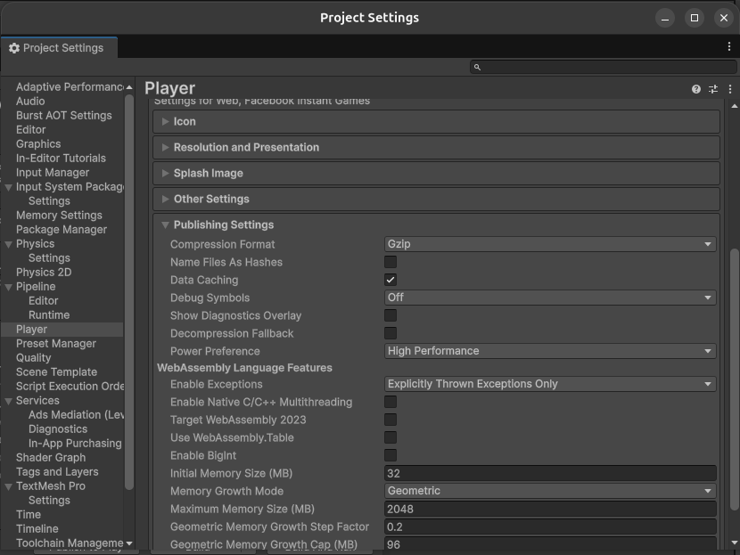
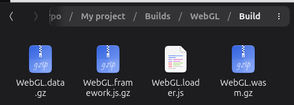
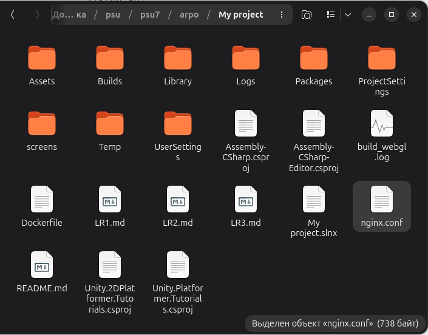
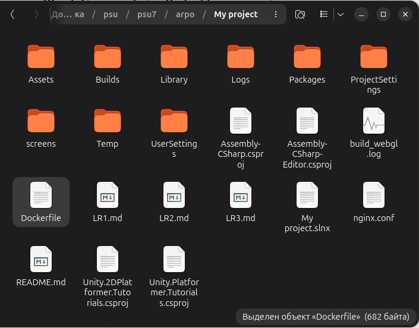
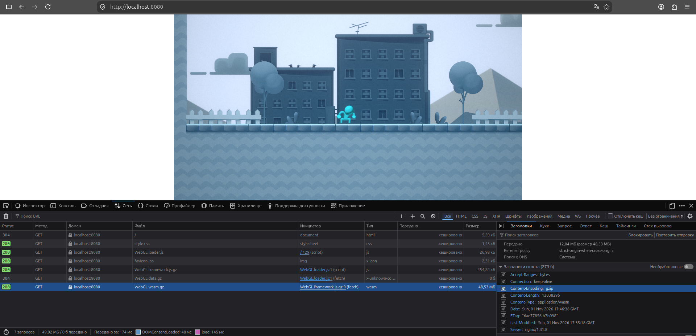

Порядок выполнения лабораторной работы 3

Шаг 1: Конфигурация сжатия в Unity 6 и локальная пересборка

Шаг 2: Создание конфигурации веб-сервера nginx.conf

Шаг 3: Создание файла Dockerfile с подменой слоев

Шаг 4: Локальное тестирование контейнера

