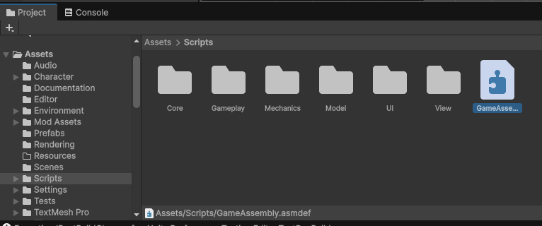
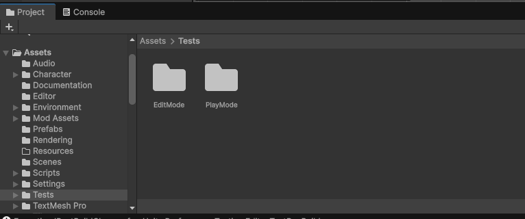
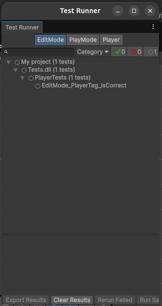
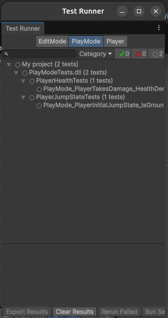
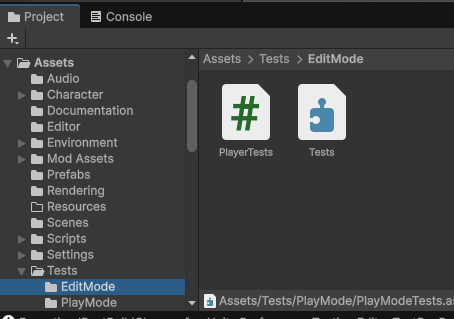
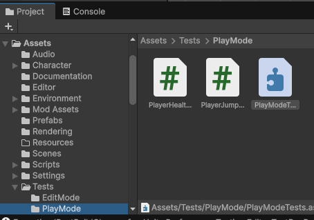
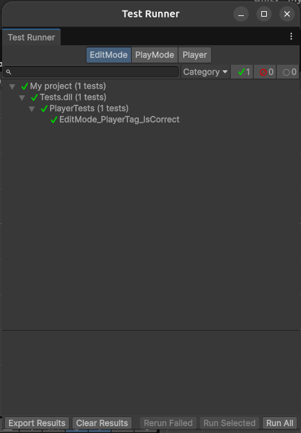
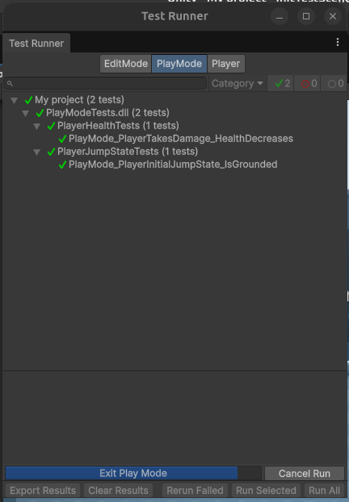
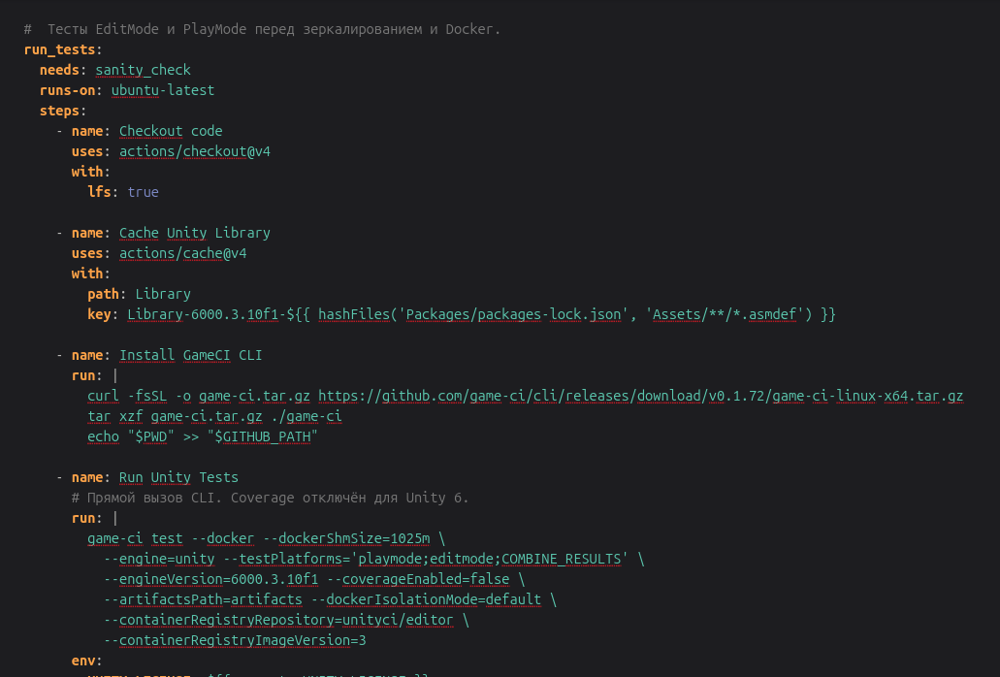
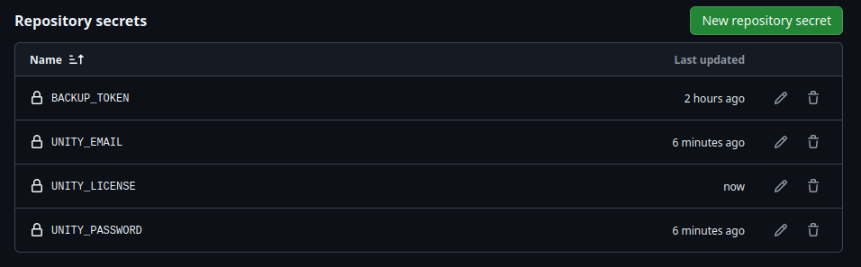

Порядок выполнения лабораторной работы 4

Вариант 7: стартовое состояние PlayerController.jumpState == Grounded.

Шаг 1: Разделение кодовой базы

Шаг 2: Написание автоматических тестов

Шаг 3: Настройка автоматического запуска тестов в GitHub Actions

Шаг 4: Безопасное добавление лицензии Unity

