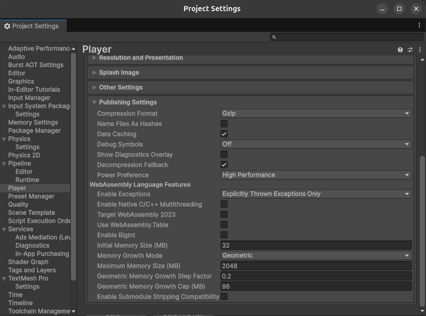
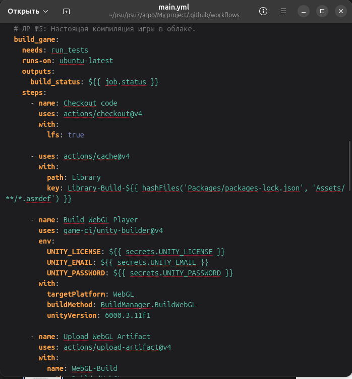
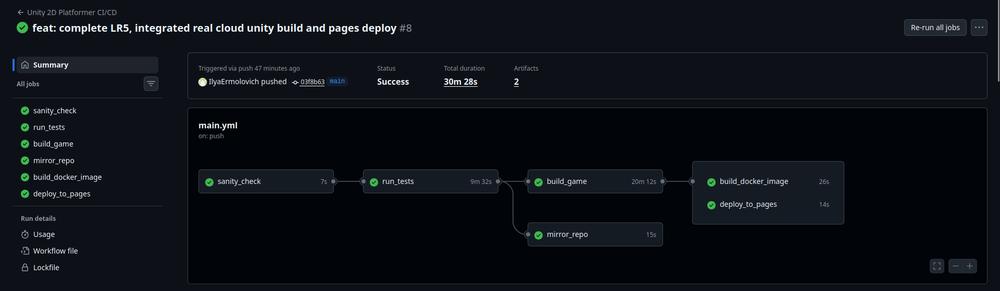
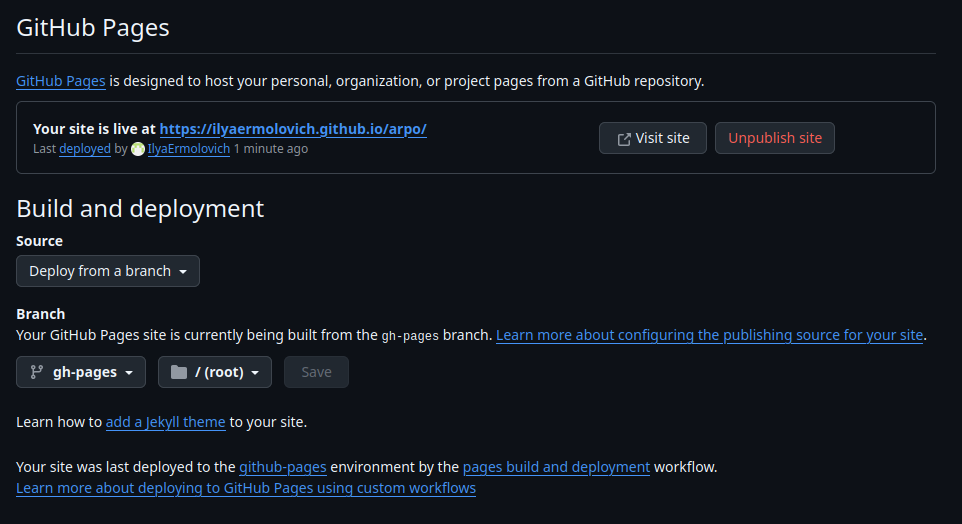
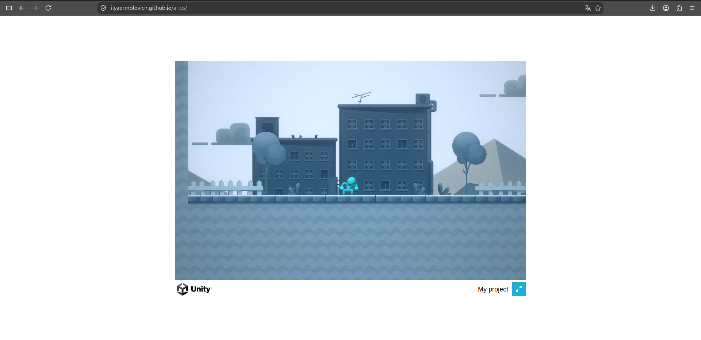

Порядок выполнения лабораторной работы 5

Шаг 1: Подготовка Unity 6 к деплою на GitHub Pages

Шаг 2: Модернизация облачного пайплайна (Добавление задачи Build)

Шаг 3: Отправка и запуск в облаке

Шаг 4: Включение GitHub Pages в настройках репозитория

Шаг 5: Проверка результатов и

